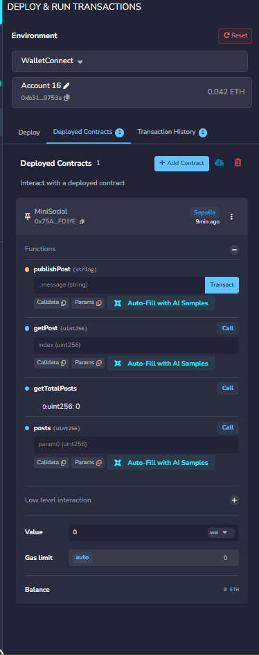
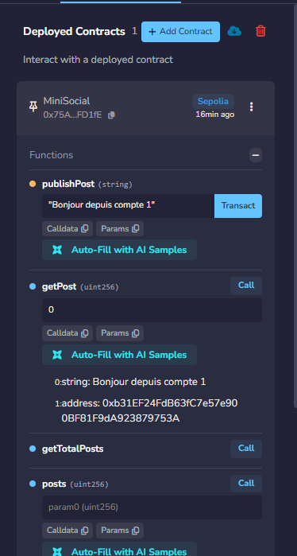

# Atelier 3 : Smart Contract « Mini Réseau Social » en Solidity

**Module :** Blockchain — 2026/2027
**Auteur :** _[Votre nom et prénom]_
**Encadrante :** Pr. Ikram BEN ADBEL OUAHAB
**Outils :** Remix IDE, MetaMask, réseau de test Sepolia (SepoliaETH)

---

## 1. Objectif

Réaliser un smart contract `MiniSocial` permettant à des utilisateurs de publier des messages stockés sur la blockchain, de consulter un message par son index et de connaître le nombre total de messages.

## 2. Structure du dépôt

```
.
├── contracts/MiniSocial.sol   # Smart contract
├── webapp/index.html          # (Bonus) DApp web3.js
├── docs/screenshots/          # Captures d'écran des tests
└── README.md                  # Rapport
```

## 3. Implémentation

### 3.1 Code source (`contracts/MiniSocial.sol`)

```solidity
// SPDX-License-Identifier: MIT
pragma solidity 0.8.26;

contract MiniSocial {
    struct Post {
        string message;
        address author;
    }

    Post[] public posts;

    event PostPublished(uint256 indexed index, address indexed author, string message);

    function publishPost(string memory _message) public {
        posts.push(Post(_message, msg.sender));
        emit PostPublished(posts.length - 1, msg.sender, _message);
    }

    function getPost(uint index) public view returns (string memory, address) {
        require(index < posts.length, "Index hors limites");
        Post storage p = posts[index];
        return (p.message, p.author);
    }

    function getTotalPosts() public view returns (uint) {
        return posts.length;
    }
}
```

### 3.2 Explication

| Élément | Rôle |
|---|---|
| `struct Post` | Regroupe le message (`string`) et l'adresse de l'auteur (`address`). |
| `Post[] public posts` | Tableau dynamique stockant tous les messages publiés. Le mot-clé `public` génère un getter automatique `posts(uint)`. |
| `publishPost(string memory _message)` | Crée un `Post` avec le message et `msg.sender` (l'adresse qui appelle la fonction), puis l'ajoute au tableau avec `push`. Émet l'événement `PostPublished`. |
| `getPost(uint index)` | Fonction `view` (gratuite, lecture seule) qui retourne le message et l'auteur. Le `require` évite un accès hors limites (sinon la transaction échoue avec un `panic`). |
| `getTotalPosts()` | Retourne `posts.length`. |
| `event PostPublished` | Ajout facultatif : facilite l'écoute des nouveaux posts par une interface web. |

## 4. Déploiement et tests

### 4.1 Préparation de l'environnement

1. Installer l'extension **MetaMask** et créer un compte.
2. Activer les réseaux de test et choisir **Sepolia**.
3. Obtenir des SepoliaETH via un faucet (ex. Google Cloud Web3 Faucet, Alchemy Sepolia Faucet).
4. Créer un **second compte** (et idéalement un troisième) dans MetaMask : _Add account_ — puis leur envoyer un peu de SepoliaETH pour payer le gas.

### 4.2 Compilation (Remix)

1. Ouvrir <https://remix.ethereum.org> et créer le fichier `MiniSocial.sol`, y coller le code.
2. Onglet **Solidity Compiler** : version `0.8.26`, cliquer sur **Compile MiniSocial.sol**.
3. Résultat attendu : coche verte, aucune erreur.


### 4.3 Déploiement sur Sepolia

1. Onglet **Deploy & Run Transactions**.
2. **Environment** : `Injected Provider - MetaMask` (le réseau affiché doit être _Sepolia_).
3. Sélectionner le compte 1 (déployeur), contrat `MiniSocial`, cliquer sur **Deploy**.
4. Confirmer la transaction dans MetaMask.

| Information | Valeur |
|---|---|
| Réseau | Sepolia |
| Adresse du contrat | `0x...` _(à compléter)_ |
| Hash de la transaction de déploiement | `0x...` _(à compléter)_ |
| Adresse du déployeur (compte 1) | `0x...` _(à compléter)_ |
| Lien Etherscan | `https://sepolia.etherscan.io/address/0x...` _(à compléter)_ |



### 4.4 Scénarios de test

> Pour chaque test : changer de compte dans MetaMask, **puis** (dans Remix, liste _Account_) sélectionner le même compte avant d'appeler la fonction.

#### Test 1 — Contrat vide

- **Étapes :** appeler `getTotalPosts()`.
- **Résultat attendu :** `0`.
- **Résultat obtenu :** _(à compléter)_

#### Test 2 — Publication avec le compte 1

- **Étapes :** `publishPost("Bonjour depuis compte 1")` → confirmer dans MetaMask.
- **Résultat attendu :** transaction validée, un événement `PostPublished` dans les logs.
- **Résultat obtenu :** _(à compléter : hash, gas utilisé)_

#### Test 3 — Publication avec le compte 2

- **Étapes :** changer de compte, `publishPost("Salut, ici le compte 2")`.
- **Résultat attendu :** transaction validée.
- **Résultat obtenu :** _(à compléter)_

#### Test 4 — Publication avec le compte 3

- **Étapes :** `publishPost("Mon premier message sur MiniSocial")`.
- **Résultat obtenu :** _(à compléter)_

#### Test 5 — Nombre total de messages

- **Étapes :** appeler `getTotalPosts()`.
- **Résultat attendu :** `3`.
- **Résultat obtenu :** _(à compléter)_

#### Test 6 — Lecture des posts

| Appel | Message attendu | Auteur attendu | Résultat obtenu |
|---|---|---|---|
| `getPost(0)` | Bonjour depuis le compte 1 | adresse compte 1 | _(à compléter)_ |
| `getPost(1)` | Salut, ici le compte 2 | adresse compte 2 | _(à compléter)_ |
| `getPost(2)` | Mon premier message sur MiniSocial | adresse compte 3 | _(à compléter)_ |

#### Test 7 — Index invalide

- **Étapes :** `getPost(99)`.
- **Résultat attendu :** appel rejeté avec le message `Index hors limites`.
- **Résultat obtenu :** _(à compléter)_



### 4.5 Remarques

- `publishPost` modifie l'état de la blockchain : elle **consomme du gas** et nécessite une confirmation MetaMask.
- `getPost` et `getTotalPosts` sont des fonctions `view` : lecture **gratuite**, sans transaction.
- L'auteur est toujours `msg.sender` : il ne peut pas être falsifié par l'utilisateur.
- Les messages sont **publics et immuables** : ne jamais y écrire d'information sensible.

## 5. Bonus : interface web (DApp)

Dans l'esprit du tutoriel _Deploying & Interacting with a Smart Contract using a WebApp_, une interface `webapp/index.html` utilise **web3.js** pour publier et lister les messages.

1. Dans `webapp/index.html`, remplacer `CONTRACT_ADDRESS` par l'adresse du contrat déployé.
2. Servir le dossier `webapp` via XAMPP (`htdocs/my_webapp`) ou `npx serve webapp`.
3. Ouvrir la page, se connecter avec MetaMask (réseau Sepolia) et publier un message.


## 6. Conclusion

Ce TP m'a permis de : définir une structure et un tableau dynamique en Solidity, utiliser `msg.sender`, distinguer fonctions de lecture (`view`) et d'écriture, et déployer/tester un contrat sur un réseau de test avec Remix et MetaMask.

## 7. Licence

MIT
